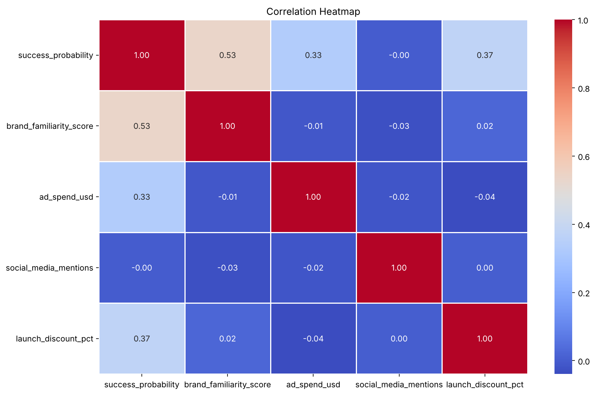
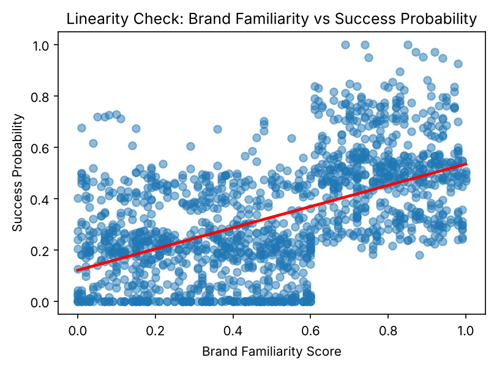

# What Drives Launch Success?

Simple and multiple linear regression on 1,500 product launches, to find which launch factors best predict a product's success probability.

**Tools:** Python, pandas, statsmodels, scikit-learn, SciPy, matplotlib, seaborn, Jupyter\
**Notebook:** [notebooks/product_launch_regression.ipynb](notebooks/product_launch_regression.ipynb) ([view in nbviewer](https://nbviewer.org/github/rahat28ahmed/product-launch-regression/blob/main/notebooks/product_launch_regression.ipynb))

## Key Results

- Brand familiarity has the strongest correlation with success probability (0.53), followed by launch discount (0.37) and ad spend (0.33). Social media mentions show no relationship (-0.00).
- On its own, brand familiarity explains 28.6% of the variation (R-squared 0.286, coefficient 0.4133). Launch discount explains 14.0% (R-squared 0.140, adjusted 0.139). Durbin–Watson values of 1.97 and 1.96 show no autocorrelation in either model.
- Adding social media mentions to the two-predictor model barely changed it (R-squared 0.416 to 0.417, p = 0.531).
- The best model used brand familiarity, discount and ad spend, with R-squared 0.541 (adjusted 0.540) and the lowest AIC (-1426.42, against -1069.85 for the baseline). All three predictors were significant at p < 0.001.





Further diagnostics: [residuals against fitted values](figures/residuals_vs_fitted_model1.png) and [Q–Q plot](figures/qq_plot_model1.png) for the brand familiarity model.

## Question

Where does effort before and during a launch pay off most? The project tests four candidate predictors (brand familiarity, launch discount, advertising spend and social media mentions) against `success_probability`, and asks how much of the variation a small set of them can explain together.

## Data

- A teaching dataset provided by the module: 1,500 product launches, 17 columns, no missing values.
- Dependent variable: `success_probability` (0 to 1).
- Candidate predictors: `brand_familiarity_score` (0 to 1), `launch_discount_pct` (0 to 40), `ad_spend_usd` and `social_media_mentions`.
- The dataset is not redistributed in this repository. See [data/README.md](data/README.md) for the expected filename and columns.

## Approach

1. Checked the shape, data types and summary statistics, and scaled the numeric columns to 0–1 with `MinMaxScaler` to compare their distributions in one histogram grid.
2. Built a Pearson correlation matrix and heatmap for the outcome and the four candidate predictors.
3. Fitted two simple OLS models with `statsmodels`, one on brand familiarity and one on launch discount.
4. Checked the assumptions for both simple models: linearity (regression plot), independence of errors (Durbin–Watson), constant variance (residuals against fitted values with a LOWESS line) and normality (histogram and Q–Q plot).
5. Fitted multiple regression models, starting with brand familiarity and discount, then adding social media mentions, then swapping it for advertising spend, and compared them on R-squared and AIC.

## Limitations

- Brand familiarity behaves more like a threshold than a straight line. In the scatterplot, success probability jumps at a score of about 0.6 and is fairly flat on either side, so the linear coefficient averages over a step.
- Many launches have a success probability of exactly 0, which creates the straight lower band in the residual plots and the short lower tail in the Q–Q plots.
- The data is teaching data provided by the module, so the coefficients describe this dataset rather than real launches.
- Models were compared on in-sample R-squared and AIC only; there is no hold-out or cross-validation.
- The final model's condition number is large (2.47e+04). The write-up attributes this to the scale of `ad_spend_usd` rather than multicollinearity. Residual checks were run on the two simple models only, not on the final model.

## Repository Structure

```
product-launch-regression/
  README.md
  requirements.txt
  LICENSE
  data/README.md          # expected dataset (not included)
  figures/                # charts saved by the notebook
  notebooks/product_launch_regression.ipynb
```

## How to Run

```
python -m venv .venv
source .venv/bin/activate        # Windows: .venv\Scripts\activate
pip install -r requirements.txt notebook
```

Place `Dataset.xlsx` in `data/` (see [data/README.md](data/README.md)), then:

```
jupyter notebook notebooks/product_launch_regression.ipynb
```

## Context

Completed as coursework for Advanced Analytics: Statistics and Machine Learning (COMP1942), MSc Business Analytics, University of Greenwich, 2025–26.
